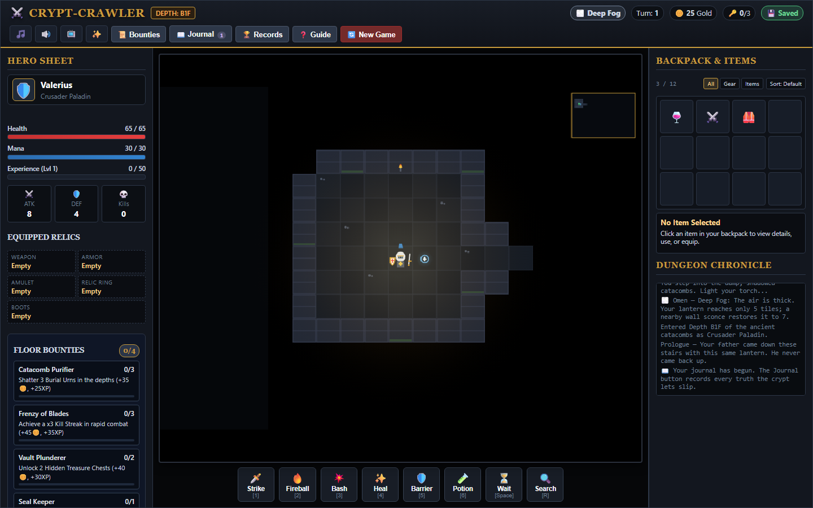
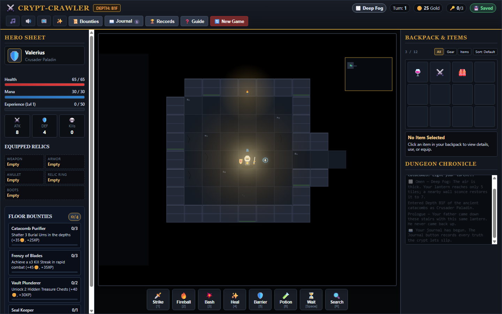

# crypt-crawler

<!-- aegean:media:start -->
<p align="center"></p>
<p align="center"><a href="LICENSE"></a> <a href="https://github.com/AegeanWorks/AIKit"></a></p>
<!-- aegean:media:end -->


Tactical turn-based web dungeon crawler with procedural levels, Normal/Hard difficulty, class passives, status combos, per-floor omens, a turn-cost trap search and disarm, mimic chests, a two-way merchant, seed replay, five-slot equipment, side-by-side loot comparison, filterable inventory, a persistent lore codex, branching soul encounters, risk-for-power black pact altars, sigil-sealed vaults, hover-annotated props, ranged and lunging enemies, phased boss fights, and headless browser inspection.

## ⚡ 30-Second Cold-Start Quick Reference

- **Runtime Prerequisites**: Python 3.10+ (Standard Library only for runtime; Playwright with Edge for visual UI inspection)
- **Canonical Regression Shield Gate**:
  ```bash
  python -m unittest discover -s tests
  ```

### 🎮 One-Click Launch
- **Windows**: Double-click `PLAY.bat` (automatically detects Python, starts server, and launches default browser)
- **Linux/macOS**: Run `./play.sh`
- **Manual Command**:
  ```bash
  python run.py --open
  ```

### 📸 Headless Browser UI Review & Inspection
```bash
python tools/inspect_ui.py --viewports desktop,laptop,mobile --scenario all --out .inspect
```
The inspector runs the full interactive audit, reports every audit check and exits non-zero when any check or console error fails, so it can gate a commit.

### 🤖 AI Mechanics Harness (deterministic, JSON in / JSON out)
```bash
python tools/ai_harness.py catalog
python tools/ai_harness.py play --seed 42 --class paladin --difficulty hard --actions @actions.json
python tools/ai_harness.py play --script run.json
python tools/ai_harness.py selftest
```
`catalog` prints the classes, their passives, the five deck abilities, every action field, the pact choices, the difficulty keys and the state keys. `play` drives the shipped JavaScript engine in headless Edge, installs a seeded `Math.random`, and prints one JSON object per run: each step plus the final state (player, monsters, props, log tail, `layout_hash`). Because the RNG is seeded, the same seed, class, difficulty and action list reproduce the same dungeon, so an agent can test a mechanic, change the code, and diff the result; `layout_hash` fingerprints every seeded decision, including rooms, biome, omen, room themes, monsters, props, merchants, traps plus trap kinds, and sconces. `selftest` proves the harness and the mechanics it exposes (layout determinism, deck labels per class, class passives, sconce light, difficulty scaling and resume, all three pact bargains surviving turns, boss damage, Dread Necromancer hexing at range, save round-trip, Scroll of Inferno consumption, number-row hotkeys casting instead of moving, numpad movement, single-flight floor descent and new-run precedence) and exits non-zero on any failure. Script file shape:
```json
{"seed": 42, "depth": 1, "class": "rogue", "difficulty": "hard",
 "actions": [{"action": "move", "dx": 1, "dy": 0}, {"action": "ability", "slot": 2}]}
```
`use_item` takes a zero-based backpack index; `player.inventory` in the reply is in the same order, and an index shifts after a consumable is removed.
Actions come from `--script run.json` or `--actions @file`; PowerShell and `cmd` strip the inner quotes of a literal JSON argument, so the file forms are the shell-safe ones and an inline parse error says so. Every action is validated before a browser starts, a rejected action (for example `teleport` into a wall) is reported in `steps[].error` with exit 1 instead of a traceback, and an uncaught page error fails the run. Playwright with Edge is only needed for `play` and `selftest`; `catalog` and the unit tests run on the standard library.

### 🧱 UI Guard (AIKit `aikit ui`)
`.aikit/ui.json` declares the `game-ui` surface (`static/**`), the protected paths, the fast proof (`python -m unittest discover -s tests`) and the inventory command (`python tools/ui_inventory.py`), which prints one stable line per control, choice, handler group and theme token.
```bash
cd ../..        # AIKit root (portable_agent_kit/)
python aikit.py ui begin crypt-crawler --surface game-ui
python aikit.py ui verify crypt-crawler      # add --json for stable finding codes
python aikit.py ui finish crypt-crawler --reviewed
python aikit.py ui abort crypt-crawler
```
`begin` needs a clean, green baseline; `verify` rejects edits outside the surface, protected-path changes, diff-budget overruns, a lost inventory entry, hardcoded colours outside the theme paths, and a failed proof; `finish` also records the human review. Delivery guards (`check --strict`, `publish`) refuse an open UI task; this project already sets `ui_required: true`, so a finished `game-ui` task is part of delivery.

### 📱 Mobile Layout
Below 768px the three panels stack into one vertically scrolling column; the action deck and the on-screen movement D-pad stay fully visible above it, and the header wraps instead of overflowing sideways.

### 🖥️ Canvas Fit & Click-to-Move
The canvas keeps its native 760:540 ratio, so the frame hugs the drawn map instead of leaving black letterbox bands; on a 1920x1080 screen it fills up to 1100px wide (about 66px tiles). Clicking a visible tile moves one step toward it, and clicks outside the drawn bitmap are ignored, so the pointer never maps into fog or rock.

### 📜 Chronicle Readability
The Dungeon Chronicle auto-scrolls to the newest line. Scroll it back and the top edge fades instead of shearing the top line mid-glyph, so the oldest visible line reads as history rather than damage.

### 🕯️ Biome Readability
The crypt, cavern and inferno biomes keep distinct palettes; the B2F cavern's visible floor and wall stones are bright enough to read the room shape at a glance, while unexplored tiles stay black and the water shimmers keep the dark-cavern mood.

### 🗺️ Minimap Key
The minimap names every blip: Stairs (gold), Chest (orange), Shop (purple), Sigil (blue), Vault (dark gold), Trap (amber), Shrine (teal), Pact (red) and Soul (lilac). The green blip is the hero and red dots are visible enemies.

### 🎲 Seeds
The class-selection screen accepts an optional positive run seed; leave it blank for a random run. The same seed, class and difficulty reproduce the same dungeon, and the Records modal shows the current seed with a **Copy Seed** button so a run can be replayed or shared.

### 📖 Records & Bestiary
The Records modal persists runs, victories, deepest floor, kills, streaks and gold, plus a codex of every enemy you have slain. Each killable type has its own row — including the Choir Echoes that split from the Hollow Choir — with a live kill count.

### ⚔️ Difficulty
New Game offers **Normal** and **Hard**. Hard multiplies enemy max HP by 1.4, enemy attack by 1.25, and enemy XP and gold by 1.15; a **HARD** badge in the header marks the run. The choice survives saves and restarts, and seed plus class plus difficulty is the full reproducibility contract. The harness exposes the same choice through `--difficulty` or the script's `difficulty` field.

### 🧬 Class Passives
| Class | Passive | Rule |
|---|---|---|
| Crusader Paladin | Zeal | Slaying a foe restores 3 HP and 1 MP |
| Shadow Rogue | Executioner | +25% attack damage to foes below 30% HP |
| Arcane Mage | Arcane Focus | Spells deal +15% damage |

The passive is printed on each class card before you choose, and the in-game guide repeats it. The action deck also dims any ability the current mana cannot pay for and marks it `aria-disabled`, so a 10-MP Fireball or Nova never looks castable at 8-9 MP.

### 🔥 Status Combos
| Setup | Follow-up | Effect |
|---|---|---|
| Burning | Frost Nova | **Shatter** for +12+3×depth, consuming burn |
| Poisoned | Fireball or Scroll of Inferno | **Toxic Blast** for +12+3×depth, consuming poison |

Combos reward sequencing: apply burn with Fireball, then shatter it with Frost; or poison with a dagger/Shadow Strike, then detonate it with fire.

### 💥 Combat Feedback
When several enemies land hits in one enemy phase, their damage numbers stack vertically instead of drawing on top of each other, so a twin hit reads as two numbers that add up to the HP actually lost. When the killing blow lands, the HP bar drops to zero and a ☠ **YOU PERISHED** marker holds for 0.75s before the death ledger opens, so the final hit is visible. The skull marker and **EXECUTE** hover suffix appear only for the rogue — the class with the Executioner passive — and the hover strike range includes the +25% execute bonus; other classes see the plain range.

### 🏷️ Hover Cards
Champion names already start with their affix (Swift, Fortified, Molten, Vampiric), so the hover card does not repeat it; boss cards keep a right-aligned BOSS badge. Long titles are measured and ellipsized before they can spill past the card edge. Poison or burn that finishes the hero ends the turn immediately and names the status as the cause; no later enemy acts after the hero falls.

### 🏹 Projectiles
Bone arrows render as fletched arrows rotated along their flight; spells keep a glowing head with a short tapered trail, so a physical ranged hit reads differently from a hex or a fireball.

### 🎭 Floor Omens, Mobs and Story
Every floor carries one omen chosen deterministically from the seed: **Blood Moon** (enemies strike 25% harder), **Deep Fog** (lantern 5 tiles, or 7 near a wall sconce), **Gilded Crypt** (+50% chest and urn gold), **Restless Dead** (one extra enemy), **Ember Tithe** (chests pay 25% less, shrines heal +15) or **Hollow Silence** (more traps, disarm XP x2). The header pill names it, the chronicle announces it, and the journal keeps it.

Wall sconces are real light sources: standing within two tiles restores the lantern to 7, so Deep Fog has a positional counterplay instead of a flat penalty.

| Enemy | From | Behaviour |
|---|---|---|
| Skeletal Archer | B2F | Fires a bone arrow up to 4 tiles when it has line of sight; does not close to melee |
| Dread Necromancer | B2F | Chants a grave bolt up to 5 tiles with line of sight; corner it to force melee |
| Crypt Hound | B2F | Lunges two tiles per turn and never lets the scent go |
| Gilded Mimic | any chest | Disguised as a chest; opening it springs a scaled fight instead of loot |
| Pact-Bound Wraith | any | Raised in pairs by the Pact of Avarice and hunts the debtor |
| Elder Vault Warden | B2F vault | Enrages at 50% (+15% ATK), hardens at 25% (+2 DEF); kite it |
| Hollow Choir | B2F restless/silent | Hums 1 turn before a 2-tile verse (break LOS to avoid), splits at 50%, stunning silence at 25% |
| Arch-Lich Malakor | B3F | Inhales 1 turn before Soul Drain (break LOS/range to avoid); summons at 50%, enrages at 25% |

Enemies step axis-first toward a visible hero; when a chest, urn or corner blocks that step, they take the shortest free path around it, so a melee foe no longer stalls behind a prop. Boss phase text is per boss: Malakor alone tears open the vault floor and enrages, the Hollow Choir's 50% split searches a wider ring when its adjacent tiles are crowded, and foundry bosses break their own seal — no boss borrows another's announcement.

Chests can be **Gilded Mimics**: opening one pushes you back and springs a depth-scaled fight instead of paying gold. The mimic is chosen deterministically from the run seed and chest order, so a known seed reproduces the same trapped chest. Trap search reveals traps, not mimics.

QoL: `?` opens the guide, `R` searches for traps, `Escape` closes any dialog, and the 🎞️ header button toggles reduced motion (persisted, disables screen shake and pulsing accents). Story: three new codex entries — *Signs in the Blood*, *The Lantern-Keeper* and *The Debt of Malakor* — plus *Ember Tithe*, *Hollow Silence* and *Hollow Choir*, and a victory epilogue that closes the ledger.

### 🔍 Trap Search
Press `R` or the deck's **Search** button to spend a turn revealing armed traps within three visible tiles. Traps come as **Spike** (8-13), **Dart volley** (4-6 x2) and **Snare** (0-2 + stun 1); a revealed trap gets a dashed amber grille and a hover card with odds, but it still triggers if stepped on: the search buys information, not safety. Press `R` again while beside a revealed trap to disarm it for `4+depth*2` XP (`x2` on Hollow Silence); the trap becomes a grey crossed grille, is safe to cross, and stays disarmed in saves. The revealed state survives saves; each new floor starts with fresh hidden traps. Deep Fog shortens the search because it uses the same line of sight as the lantern.

### 🏛️ Room Themes
Each generated room carries one of five themes — chapel, ossuary, gallery, urn crypt or choke — and leaves a faint floor emblem at its centre (cross, skull, arches, urn, chevrons), so a floor reads at a glance even before you hover a prop. Choke rooms hide more traps and gallery rooms fewer; the emblem itself is cosmetic and changes no rule. Themes are saved with the run, so a resumed floor keeps its chapels and urn crypts instead of repainting every room as an ossuary.

### 🔊 Audio Cues
Skeletal Archers play a bow-release twang before the impact, and the Hollow Choir's hum and Malakor's inhale play a rising telegraph tone as they charge, so an off-screen windup is audible before it lands. Trap search plays a sonar ping, disarming plays a metallic clank, and each trap kind has its own trigger cue (spike thud, dart double-tick, snare snap) instead of a generic hit. The header speaker button mutes SFX without touching saves.

### 💾 Saves & Resume
The run autosaves after every turn under `crypt_crawler_save_v2`. On load the game resumes only a save whose `version` matches the shipped format (currently 2); a save from a newer or unknown version is refused with a console warning and left in storage, so a build downgrade cannot half-load or corrupt a run. Death and victory clear the save.

### 🧳 Merchant
Hermit Grimbold opens a two-tab shop on B2F and deeper. **Buy** spends gold on potions, gear and relics (15-140, rebalanced: Health 20, Hammer 115); **Sell** converts outclassed backpack loot into gold at a rarity-based price (common 10, rare 30, epic 60, legendary 100). The shop stays open after a sale, so a full 12-slot backpack can be cleared in one visit, and selling is refused once the shop is closed. The Crown of Eternity is a trophy, not stock: it never appears in the Sell tab. Chests pay 17+0-13 base with a 2.4x jackpot capped at 3.0x with omens; urns pay 6+0-10 with the same cap, so risk-for-power stays a real choice.

### 🎰 Stated Odds (audited, never "feels more fun")
| Source | Rate | Payout | Proof |
|---|---|---|---|
| Chest relic | 14% | base gold + rare relic | `python tools/engagement_metrics.py --seeds 42,777,12345 --depths 1,2,3` |
| Chest jackpot | 20% (roll 0.14-0.34) | 2.4x, omen-capped 3.0x | `tests/test_odds_parity.py` reads `static/js/engine.js` |
| Chest standard | 66% | base gold x omen | same as above |
| Urn jackpot | 18% | 2.4x, omen-capped 3.0x | same as above |
| Soul toll relic | 50% | one of 4 rares, if backpack fits | stated here, coded in `engine.js:resolveSoul` |
| Mimic floor | 1-in-4 floors with chests | fight, no loot | `mimicChestIndex` hash |
| Near-miss survival surge | <=28% HP + >=6 dmg | +2 MP, +6 DEF 3 turns, max 1/floor then flavor | `crawler/engagement.py:ENGAGEMENT_TUNING["surge"]` |

Ethics line: tension yes, manipulation no. No empty chests, no low-HP farming (surge capped), no timers, no pay-to-win, no sunk-cost loops.

### 🛠️ AIKit Commands (run from the AIKit folder)
| Role | Command |
|---|---|
| Status, task and gates | `python aikit.py status crypt-crawler` |
| Phase 4: every gate | `python aikit.py check crypt-crawler` |
| Repair memory and map, then check | `python aikit.py fix crypt-crawler` |
| Resume an interrupted task | `python aikit.py resume crypt-crawler` |

The `mechanics` gate runs `python tools/ai_harness.py selftest`, declared in `.aikit/project.json` as `mechanics.core` (the headless rules: `crawler`, `static/js`, `tools/ai_harness.py`) and `mechanics.test`, so a mechanics regression fails the same gate set as the unit suite.

## 📦 What's Inside

```text
crypt-crawler/
├── .gitignore                <- transient state & screenshots excluded
├── assets/                   <- reviewed logo, social preview and screenshots
├── LICENSE                   <- Aegean Game License 1.1 (AGL-1.1): DRM-free personal play
├── LICENSES/                 <- REUSE license texts
├── REUSE.toml                <- Machine-readable SPDX metadata
├── ASSETS.md                 <- Asset/data manifest: what the license covers
├── PLAY.bat                  <- Windows one-click launcher
├── play.sh                   <- POSIX one-click launcher
├── README.md                 <- documentation and quickstart
├── COMMERCIAL.md
├── run.py                    <- lightweight HTTP server entrypoint
├── crawler/                  <- Python engine package
│   ├── __init__.py
│   ├── dungeon.py            <- procedural dungeon generator
│   ├── entities.py           <- player and monster simulation
│   ├── combat.py             <- combat calculations and status effects
│   ├── lore.py               <- codex entries, pact altars and discovery events
│   ├── engagement.py         <- engagement tuning table (single Python source of truth)
│   ├── rewards.py            <- variable-ratio jackpots, near-miss & bounties
│   ├── foundry_packs.py      <- foundry boss-pack loader (packs are data installs)
│   └── server.py             <- HTTP request handler & REST endpoints
├── packs/                   <- installed foundry boss packs (JSON data)
├── static/                   <- Web UI assets (zero build step)
│   ├── index.html            <- modern responsive HTML5 shell
│   ├── css/
│   │   └── style.css         <- dark fantasy UI, glowing HUD, layout
│   └── js/
│       ├── engine.js         <- game loop, turn management, state
│       ├── dungeon.js        <- client dungeon state & fog of war
│       ├── renderer.js       <- procedural canvas tiles & lighting
│       ├── ui.js             <- HUD, inventory panel, combat log
│       └── audio.js          <- Web Audio API synthetic SFX synthesizer
├── tools/
│   ├── inspect_ui.py         <- Playwright headless Edge UI inspector
│   ├── ai_harness.py         <- seeded JSON gameplay harness for agents
│   ├── engagement_metrics.py <- deterministic engagement metrics (seed x depth matrix)
│   ├── record_replay.py      <- pins replay hashes for seed x depth combos
│   ├── validate_fairness.py  <- rejects unwinnable/unfair seeds
│   ├── verify_replay.py      <- checks live dungeons against pinned hashes
│   ├── replay_transcripts/   <- pinned replay hashes (pins.json)
│   └── ui_inventory.py       <- deterministic control/handler inventory
├── tests/
│   ├── __init__.py
│   ├── test_ai_harness.py    <- harness validation and UI inventory tests
│   ├── test_audio_cues.py    <- bow-release and boss-telegraph audio cues
│   ├── test_bestiary.py      <- every killable type has a Records row
│   ├── test_boss_phases.py   <- Malakor, Choir and pack bosses own their phases
│   ├── test_canvas_fit.py    <- canvas aspect-ratio and pointer-mapping contract
│   ├── test_cavern_contrast.py <- B2F cavern floor/wall readability floor
│   ├── test_chronicle_fade.py <- scrolled chronicle fades its top edge
│   ├── test_combat.py        <- combat rules tests
│   ├── test_death_beat.py    <- HP/feedback before the delayed death ledger
│   ├── test_death_cause.py   <- status causes end the turn and name the cause
│   ├── test_deck_costs.py    <- deck dimming matches the engine mana costs
│   ├── test_dungeon.py       <- procedural generation tests
│   ├── test_enemy_pathing.py <- blocked melee steps detour around props
│   ├── test_execute_marker.py <- skull/EXECUTE preview belongs to the rogue
│   ├── test_fairness.py      <- fairness validator tests
│   ├── test_foundry_packs.py <- foundry pack integration tests
│   ├── test_hover_title.py   <- champion/boss hover title fit contract
│   ├── test_inspect.py       <- inspection configuration tests
│   ├── test_lore.py          <- codex data and /api/lore endpoint tests
│   ├── test_minimap_legend.py <- every minimap colour is named in the legend
│   ├── test_rewards.py       <- reward jackpots, near-miss & bounty tests
│   ├── test_room_themes.py   <- every generated room theme has a rendered emblem
│   ├── test_save_version.py  <- one save version constant, unsupported saves refused
│   ├── test_engagement.py    <- tuning table bounds, determinism, distribution tests
│   ├── test_odds_parity.py   <- stated-vs-coded odds parity tests
│   ├── test_projectile_style.py <- arrows read physical, spell bolts keep a trail
│   ├── test_server.py        <- web server endpoints tests
│   └── test_swarm_fixes.py   <- swarm-triage verified regression locks
└── .aikit/                   <- project memory: record, ledger, decisions, ui.json guard
```

<!-- aegean:brand-assets:start -->
## 🎨 Brand Assets

> **AI-Generated Brand Artwork.** The banner and logo are **AI-generated brand assets**. They are illustrative and may not literally depict every feature or the full project scope.
<!-- aegean:brand-assets:end -->

## 📜 License

Free for personal play under the Aegean Game License 1.1 (AGL-1.1); see [LICENSE](LICENSE). It is DRM-free: Licensor ships no DRM and a distributor may not add it. Streaming, modding and free mods are allowed. Commercial use, paid mods and AI training need the Aegean Commercial License 1.0 (ACL-1.0); see [COMMERCIAL.md](COMMERCIAL.md).

<!-- aegean:screenshots:start -->
## Screenshots

<a href="https://github.com/AegeanWorks/Crypt-Crawler/commit/1b9f612"></a>

<a href="https://github.com/AegeanWorks/Crypt-Crawler/commit/c9cfd16"></a>

*commit `c9cfd16` · 2026-11-03 · viewport 1440x900 · the 2026-10-28 black-canvas capture was the before, 2026-10-31 the after; 2026-11-03 confirms the renderer rework*
<!-- aegean:screenshots:end -->
